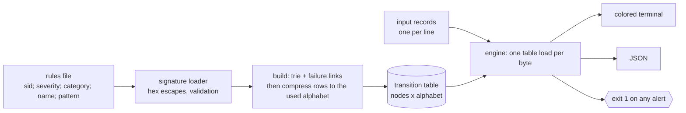
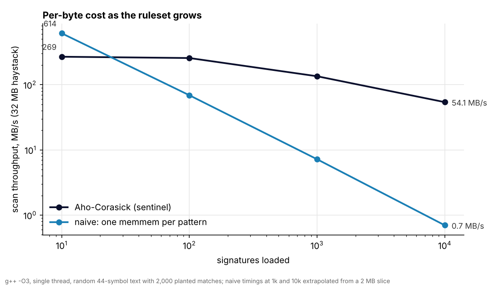

# sentinel

[](https://github.com/jcedrik/sentinel/actions/workflows/ci.yml)
[](LICENSE)


A multi-signature detection engine written in C++. It scans input (log lines, reassembled payloads) against a ruleset of byte signatures and reports matches with severity and category, in a single pass over each record regardless of how many rules are loaded.

I built this to understand how a real IDS does pattern matching under the hood, instead of treating it as a black box. The core is an Aho-Corasick automaton I implemented from scratch.

## Why Aho-Corasick

A detection engine tests many signatures against the same bytes. The naive approach runs one substring search per rule: with N rules over text of length T that is O(N x T). Aho-Corasick compiles all the patterns into a single finite automaton and finds every occurrence of every pattern in one pass, in O(T + matches) after an O(total pattern length) build.

Concretely: loading 10 rules or 10,000 rules costs the same per byte scanned. The work moves to build time, where the automaton's failure links are computed once.

The automaton is a trie of all patterns, augmented with failure links. A failure link points from a node to the longest proper suffix of the string reaching it that is also a prefix of some pattern, so when a match breaks the engine falls back to the best still-viable state instead of restarting. I precompute every transition during build (the "goto" automaton), so the scan loop is one table lookup per input byte with no branching on missing edges.

See `include/aho_corasick.hpp` and `src/aho_corasick.cpp` for the implementation and comments.



## Measured

`make bench` scans a 32 MB haystack with 10 to 10,000 signatures, against a naive engine that runs one `memmem` per pattern. Full table and method in [`bench/RESULTS.md`](bench/RESULTS.md).



| Signatures | sentinel (MB/s) | naive (MB/s) | ratio | automaton table |
|---:|---:|---:|---:|---:|
| 10 | 269 | 614 | 0.4x | 0.02 MB |
| 100 | 257 | 69 | 3.7x | 0.3 MB |
| 1,000 | 135 | 7.2 | 19x | 2.3 MB |
| 10,000 | 54 | 0.7 | 77x | 22 MB |

Two things the numbers say that the textbook does not. Below ~30 signatures a SIMD `memmem` loop beats the automaton, so for a tiny ruleset you do not want this. And the automaton's curve is not flat: per-byte work is constant, but the transition table outgrows the cache around a thousand patterns and the cost becomes memory latency. Compressing the rows from 256 bytes to the 44 symbols the ruleset actually uses (done in `build()`) cut the table 6x and bought 1.4x to 1.9x across the board; it is the single most effective change I made to this engine, and I only found it by measuring.

## Build

```bash
make          # builds the sentinel binary
make test     # builds and runs the test suites
make run      # scans the bundled sample with the default ruleset
```

Requires a C++17 compiler. No external dependencies.

## Usage

```bash
sentinel --rules <file> --input <file> [--json]
```

Scan the bundled sample:

```bash
./sentinel --rules signatures/default.rules --input samples/traffic.log
```

Exit codes: `0` no alerts, `1` alerts found, `2` error. The non-zero-on-alert behavior lets it gate a pipeline.

## Rule format

One rule per line, five semicolon-separated fields:

```
sid; severity; category; name; pattern
```

The pattern is matched as raw bytes. Non-printable bytes use Snort-style `|hex|` escapes, so a NOP sled is `|90 90 90 90|` and a CRLF is `|0d 0a|`. Lines starting with `#` are comments.

Example:

```
SIG-2001; high; exploit; x86 NOP sled; |90 90 90 90 90 90|
SIG-3001; high; web; SQL injection UNION SELECT; UNION SELECT
```

A malformed line fails the load loudly with its line number, rather than silently dropping a detection.

## Design

The code is split so each piece is testable on its own:

- `aho_corasick` is the matching automaton, with no knowledge of signatures or severities. It just finds patterns in bytes.
- `signature` loads and validates the ruleset, including the hex-escape decoder.
- `engine` compiles all signature patterns into one automaton and maps matches back to the rule that fired.
- `main` is the CLI: argument parsing, colored terminal output, and JSON output for tooling.

## Tests

`make test` runs two suites: one for the automaton (the textbook overlapping-suffix case, binary-safe matching on raw bytes, and a random-text oracle that cross-checks the compressed table against brute force, including a ruleset that uses all 256 byte values), one for rule loading and end-to-end detection. 35 checks total. CI runs them on Linux (g++) and macOS (clang++), plus an AddressSanitizer / UBSan build.

## Scope and next steps

Input is read as one record per line, which covers log scanning and is reproducible and easy to test. The engine itself is input-agnostic, so a PCAP reader or live `libpcap` capture could feed records in without touching the matching core.

What I would do next, in order of measured payoff: a double-array trie and `uint16_t` state ids to flatten the throughput curve past 1,000 signatures; a PCAP reader; regex signatures alongside literal ones; per-rule hit statistics.

## License

MIT
